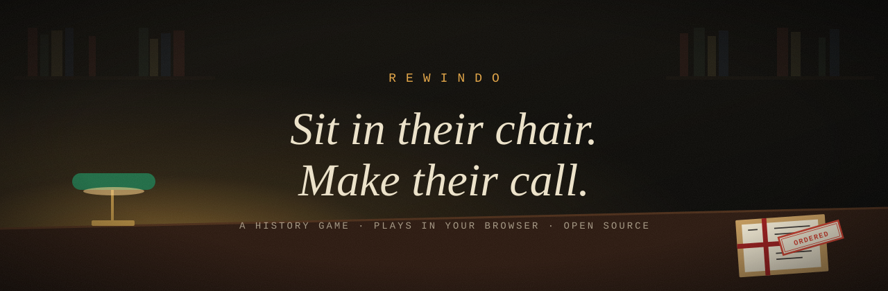
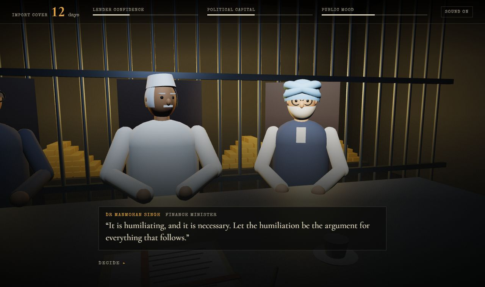
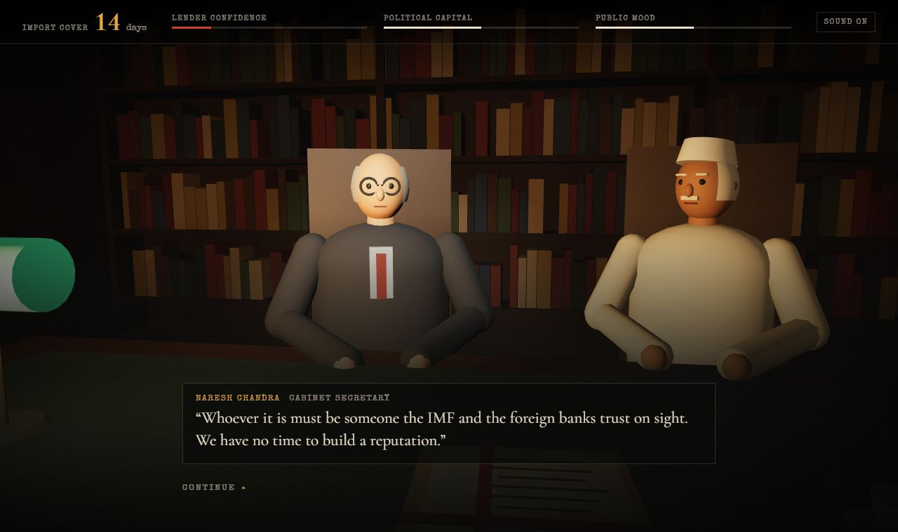
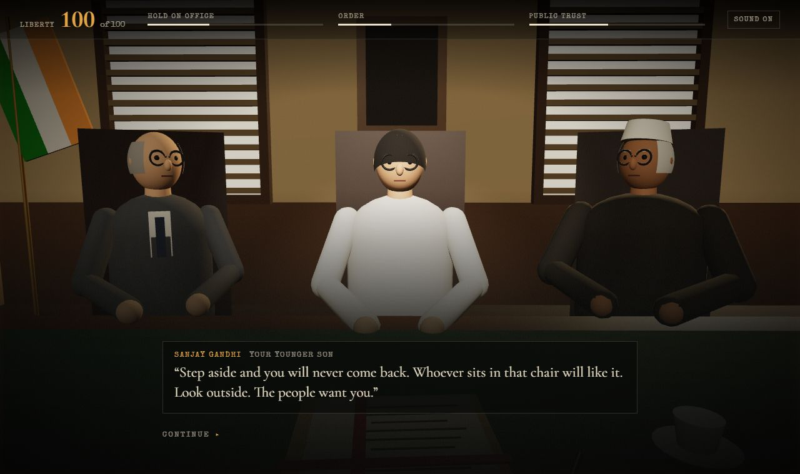
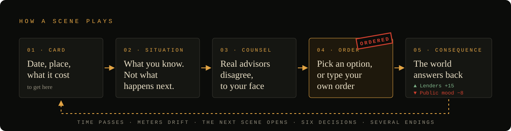
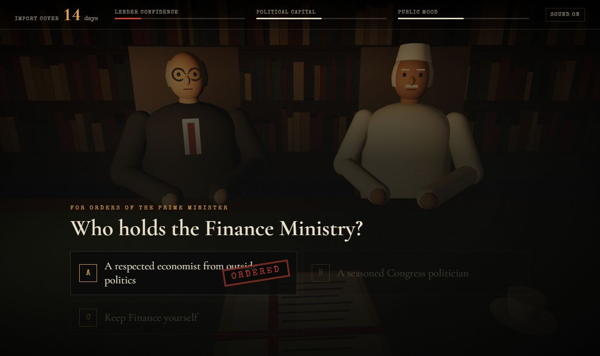
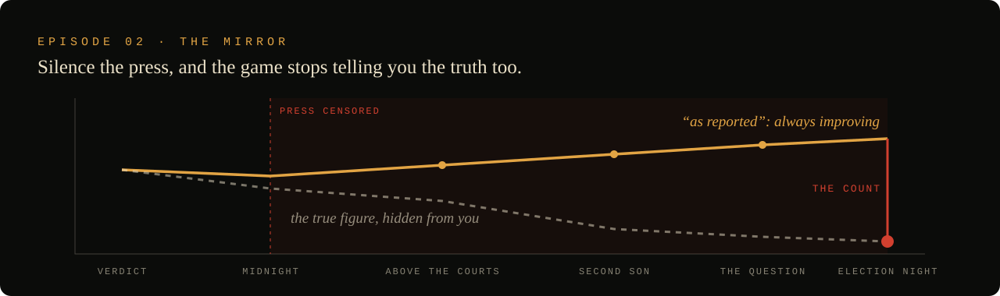
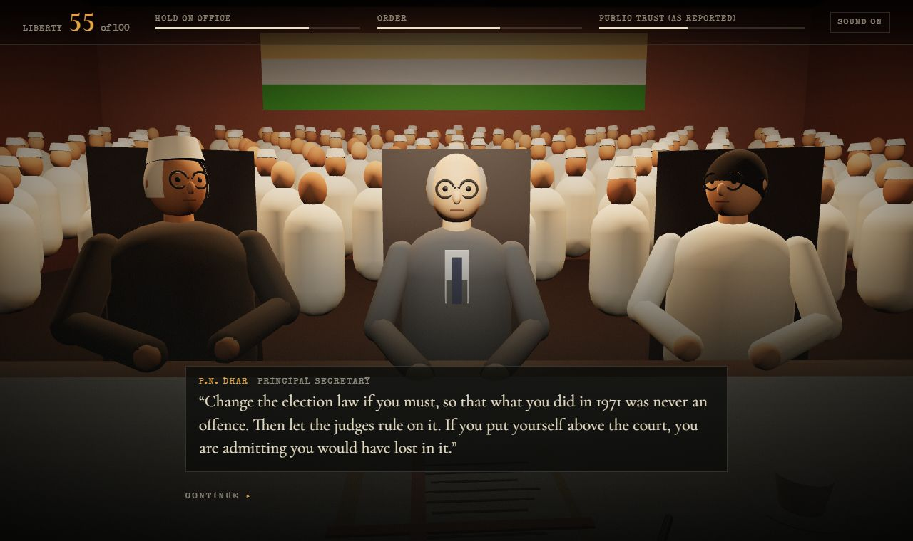
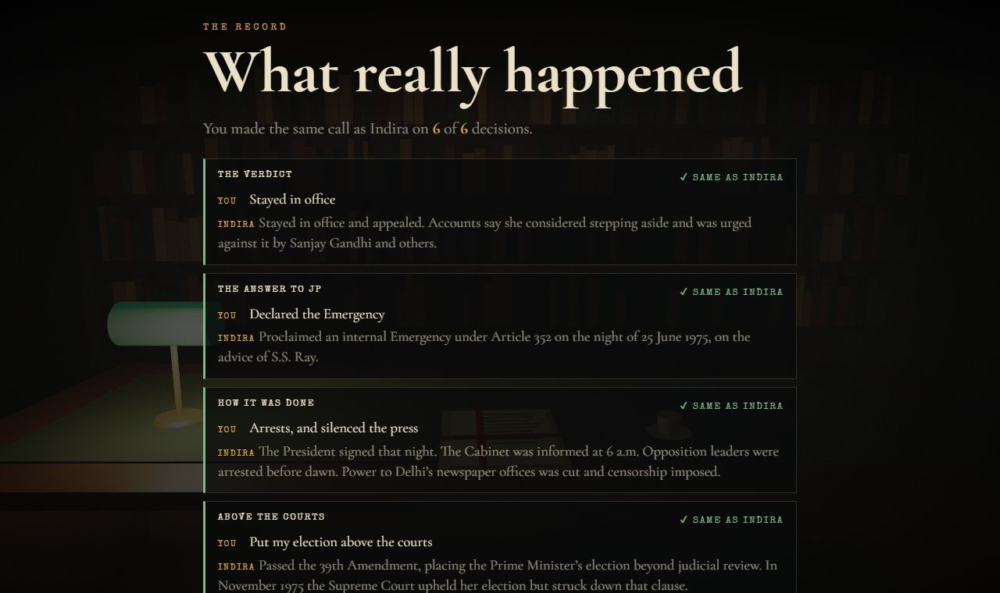
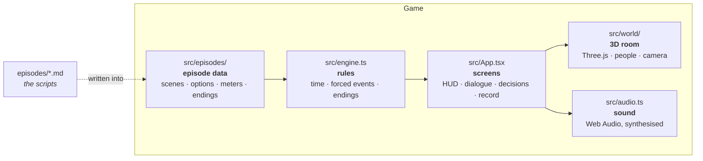

<p align="center">
  
</p>

<p align="center">
  <a href="https://realrohanroy.github.io/rewindo/"><b>▶ Play in your browser</b></a>
  &nbsp;·&nbsp;
  <a href="#run-it-yourself">Run it locally</a>
  &nbsp;·&nbsp;
  <a href="CONTRIBUTING.md">Contribute</a>
  &nbsp;·&nbsp;
  <a href="episodes/">Read the scripts</a>
</p>

<p align="center">
  
  
  
  
  
</p>

---

**It is 20 June 1991. India has fourteen days of foreign exchange left. You took the oath this morning.**

Rewindo puts you in the chair of the people who made India's hardest decisions. You sit across the table from their real advisors and hear them argue. You know only what they knew on the day. Then you sign the order and live with the result.

Each episode takes 15 to 20 minutes and runs in your browser. Nothing to install. At the end you see what really happened, decision by decision, and how your choices compare.

<p align="center">
  
  <br>
  <sub><i>Episode 01. In the Reserve Bank vault, Dr Manmohan Singh makes the case for flying the nation's gold to London.</i></sub>
</p>

---

## The episodes

<table>
  <tr>
    <td width="50%" valign="top">
      
      <h3>01 · 1991 · Two Weeks of Dollars</h3>
      <p>You are <b>P.V. Narasimha Rao</b>, leading a minority government. Reserves cover two weeks of imports and every scene costs you more days. Do you pledge the gold? Devalue the rupee? End the licence raj?</p>
      <p><sub>6 decisions · 4 endings · about 15 minutes</sub></p>
    </td>
    <td width="50%" valign="top">
      
      <h3>02 · 1975 · The Midnight Proclamation</h3>
      <p>You are <b>Indira Gandhi</b>. A court has just voided your election. Opposition rallies fill Delhi. Your son has a list of names, and the Constitution has an article that needs only one signature.</p>
      <p><sub>6 decisions · 6 endings · about 20 minutes</sub></p>
    </td>
  </tr>
</table>

Every episode is built from a script in [`episodes/`](episodes/). Read the scripts to see every branch, or play and find out.

---

## How a scene plays

<p align="center">
  
</p>

You see the room in first person. Whoever is speaking leans in and the light finds them. When you decide, your eyes drop to the file on the desk. When you choose, a red stamp comes down.

<p align="center">
  
</p>

### Meters that push back

Every episode has its own pressures, shown at the top of the screen.

- **In 1991** the big number is **days of import cover**. It falls every scene. At zero, India defaults. Under a week, the screen edge pulses red and a heartbeat joins the soundtrack.
- **In 1975** the big number is **Liberty**: courts, press and opposition, the Constitution as you found it. You always see what you are spending.

### The mirror

<p align="center">
  
</p>

Episode 02 has one mechanic you won't see coming. If you censor the press, the **Public trust** meter is relabelled *"as reported"*, and from then on it only goes up. Your advisors quote it back to you. The real figure is tracked in secret. You find out what the country thought only when you dare to ask it.

<p align="center">
  
</p>

### What really happened

At the end, every decision you faced is laid next to the real one. You get the record, the aftermath, the strongest case against the real decision, and a card to share.

<p align="center">
  
</p>

```
REWINDO · 1991
I was Narasimha Rao for six weeks.

✔ Chose an economist — like Rao
✔ Sent the gold quietly — like Rao
✘ Devalued in one shot — Rao took two steps

Ending: THE OPENING
What would you have done?
```

---

## How to play

| | |
|---|---|
| **Advance the story** | Click anywhere, or press <kbd>Space</kbd> or <kbd>Enter</kbd>. The first press finishes the line, the second moves on. |
| **Decide** | Click an option. There is no undo. |
| **Do something else** | Once per decision, type your own order. "Ask the Soviet Union for a loan." "Call the Army in." Your advisors will tell you what happens. |
| **Sound** | On by default. Turn it off from the top-right corner. |
| **Play again** | Different choices lead to different scenes. Some scenes appear only on certain paths. |

> **Tip.** Try to match the real decisions on your first run. Then play again and do the opposite of everything.

---

## Run it yourself

You need [Node.js](https://nodejs.org) 20 or later.

```bash
git clone https://github.com/realrohanroy/rewindo.git
```

```bash
cd rewindo
```

```bash
npm install
```

```bash
npm run dev
```

Then open **http://localhost:5173**.

| Command | What it does |
|---|---|
| `npm run dev` | Start the game with live reload |
| `npm run typecheck` | Check types without building |
| `npm run build` | Type-check and build a static site into `dist/` |

The build is plain static files, so `dist/` can be hosted anywhere. This repo deploys itself to GitHub Pages on every push to `main` (see [`.github/workflows/pages.yml`](.github/workflows/pages.yml)).

---

## Under the hood



| Layer | Choice | Why |
|---|---|---|
| App | Vite, React, TypeScript | Loads fast on a phone, shareable as a link. |
| 3D | Three.js | Real rooms and people inside a web page. A full game engine (Unity, Unreal, Godot) would mean tens of megabytes before the first scene. |
| Sound | Web Audio API | Every sound is synthesised in code: room drone, clock, typewriter, stamp, heartbeat. No audio files. |
| Content | One TypeScript file per episode | The engine knows nothing about any story. A new episode is a new data file. |

Characters are built from simple shapes and recognised by what people remember: a blue turban, a Gandhi cap, heavy glasses. Their definitions are in [`src/world/people.ts`](src/world/people.ts).

---

## Roadmap

- [x] Episode 01: 1991, the balance-of-payments crisis
- [x] Episode 02: 1975, the Emergency
- [x] First-person 3D rooms and characters
- [ ] An AI model behind "Do something else", kept within each episode's facts
- [ ] "X% of players chose this" on every decision
- [ ] Hindi, then more Indian languages
- [ ] Sculpted heads for closer likeness
- [ ] Episodes on 1922, 1947–48, 1965 and 1971
- [ ] Historian review of every published episode

Want to take one of these on? Open an issue and say so.

---

## Contributing

Rewindo needs historians as much as it needs programmers. You can help without writing code.

- **Fix a fact.** Spotted a wrong date, figure or name? [Open a fact correction](../../issues/new?template=fact-correction.yml). Please cite a source.
- **Propose an episode.** A moment, a person, a decision with real alternatives. [Pitch it here](../../issues/new?template=episode-proposal.yml).
- **Write an episode.** Script first, as a Markdown file in `episodes/`, then the data file. The [contributor guide](CONTRIBUTING.md#adding-an-episode) walks through it.
- **Improve the game.** Faces, rooms, sound, mobile layout, accessibility, performance.
- **Translate.** Hindi first.

Start with **[CONTRIBUTING.md](CONTRIBUTING.md)**. It covers setup, the project layout, how an episode is structured, and the content rules every episode follows.

---

## A note on history

Every line of dialogue in Rewindo is **dramatised**. The events, dates and decisions are real, but nobody recorded these conversations word for word. Each script lists the facts still to be checked and the sources to check them against.

These are contested moments with living memory. The game's rules:

- **Show both readings.** Every ending includes the strongest case against the real decision.
- **No victory laps for authoritarian choices.** Their costs are shown, even when they "work".
- **Victims are not scenery.** Violence reaches the player as testimony, never as an action they carry out.
- **Fictional composites, where honesty needs them.** "The Veteran" and "The Elder" speak for groups of real people so that no real person is given invented words.

If something here is wrong, or unfair, [tell us](../../issues/new?template=fact-correction.yml).

---

## Licence

Code and content are released under the [MIT Licence](LICENSE).

The scripts draw on published histories, listed at the end of each one in [`episodes/`](episodes/). Please read them; they are better than any game.
